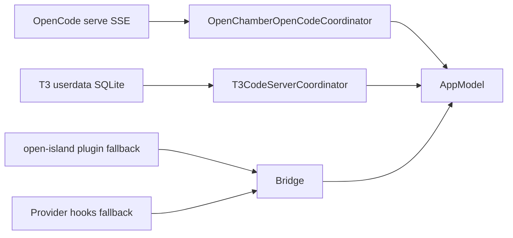

# OpenChamber and T3 Code Support

Server-primary integration for cockpit hosts. Implemented on `feat/openchamber-t3-support`.

## Design

Open Island treats OpenChamber and T3 Code like Codex.app: **connect to the host’s local server / store**, map into `AgentEvent`, feed `AppModel.applyTrackedEvent`. Provider hooks / the OpenCode JS plugin remain **fail-open fallbacks** (and still cover standalone OpenCode TUI).

Pattern copy: `CodexAppServerCoordinator` + `ProcessMonitoringCoordinator` running-state callbacks.

## OpenChamber

**Primary path:** discover managed `opencode serve` under OpenChamber.app (`OpenCodeServeDiscovery`), connect with basic auth (`OPENCODE_SERVER_PASSWORD`), sync `GET /api/session` **only for live candidates**, subscribe to `GET /global/event` SSE (`OpenCodeServeClient`), map with `OpenCodeServeEventMapper`.

- Session ids: `opencode-<ses_…>`
- Jump: activate `dev.openchamber.desktop`
- Liveness: OpenChamber app running (existing cockpit rule)
- **Stale guard:** list sync imports `busy`/`running`, or in-flight rows with no `outcome` / `time.idle` and `time.updated` within 30 minutes. Historical idle sessions are never added. SSE activity for an unseen id still seeds one card.

**Fallback:** global `~/.config/opencode/plugins/open-island.js` (OpenCode 2 `{ id, setup }`). Not required for managed OpenChamber once the server client is connected.

**Not used:** OpenChamber rail extensions (`@openchamber/sdk`) — UI panels, not island bridge.

## T3 Code

**Primary path:** poll `~/.t3/userdata/statev2.sqlite` projection tables (`T3CodeLocalStore`) while T3 is running (`T3CodeServerCoordinator`). Maps active runs → sessions tagged `terminalApp = "T3 Code"`.

- Session ids: `t3-<threadId>`
- Tool: inferred from provider (`cursor` → `.cursor`, `claudeAgent` → `.claudeCode`, …)
- Waiting / pending approval → permission card + jump to T3 (island does not approve yet)
- Jump: activate `com.t3tools.t3code`
- **Stale guard:** only runs with `completed_at IS NULL` and status in `running|starting|queued|waiting|preparing` (explicitly excludes `idle`)

**Fallback:** host-tag on Claude/Codex/Grok/OpenCode hooks when env shows T3 (`T3CODE_*` / bundle id).

**Why SQLite not WS first:** local HTTP `/api/projects` requires credentials; WS needs a protocol handshake. The projection DB is the same read model the desktop uses and needs no pairing for a same-machine companion.

## Key types / files

| Piece | Path |
|---|---|
| OpenCode discovery | `Sources/OpenIslandCore/OpenCodeServeDiscovery.swift` |
| OpenCode SSE client | `Sources/OpenIslandCore/OpenCodeServeClient.swift` |
| OpenCode event mapper | `Sources/OpenIslandCore/OpenCodeServeEventMapper.swift` |
| OpenChamber coordinator | `Sources/OpenIslandApp/OpenChamberOpenCodeCoordinator.swift` |
| T3 local store | `Sources/OpenIslandCore/T3CodeLocalStore.swift` |
| T3 mapper | `Sources/OpenIslandCore/T3CodeThreadMapper.swift` |
| T3 coordinator | `Sources/OpenIslandApp/T3CodeServerCoordinator.swift` |

## Manual check

1. Launch Open Island Dev + OpenChamber; send a prompt — island shows OpenCode · workspace with OpenChamber jump (no plugin required).
2. With T3 Code running an active thread — island shows `t3-…` card; jump activates T3.
3. Plugin/hooks still optional for standalone agents.

## Out of scope

- OpenChamber `@openchamber/sdk` rail extension
- Answering T3 approvals from the island
- npm SDKs as runtime dependencies
- Removing the OpenCode plugin installer (still useful for non-OpenChamber OpenCode)
